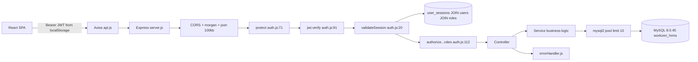

# WorkZen HRMS — Master Project Context & Development Handover

Generated: 2026-11-01 by a Phase 0 read-only audit of the working tree.
Repository: `D:\Niroop\WorkZen_HRMS` · Git: detached HEAD at `87e3950` (tag `workzen-v2.0`)

> **Method note.** Every statement below is sourced either from a file:line in the working
> tree, from a command actually executed on 2026-11-01, or is explicitly marked
> **UNVERIFIED**. Historical handover values were treated as claims and re-tested.
> No application code, no database and no `.env` file was modified. Reading `backend/.env`
> is blocked by the environment classifier; the live target schema was therefore resolved
> read-only through `SELECT DATABASE()` and reported as a classification.

---

## 1. Project overview

WorkZen HRMS is a full-stack Human Resource Management System covering authentication and
session management, employee profiles, attendance, leave, salary structures, payroll,
payslips (including PDF), and HR dashboards. Four roles are supported: **Admin, HR Officer,
Payroll Officer, Employee**.

Architecture is layered: React SPA → Axios → Express routes → JWT/RBAC middleware →
controllers → services → `mysql2` pool → MySQL 8.

Current headline state: **backend is mature and unusually well-secured; frontend is the
weakest layer.** Six confirmed frontend defects cause visible, wrong or fabricated numbers
to be shown to users, and the payroll module is the only frontend area that is fully wired
to the API end-to-end. The most severe system-wide defect found in this audit is that
**server-side logout never actually revokes the session** — proven by 232 live unreverked
session rows in the production schema.

## 2. Project objectives

1. Centralize HR operations (people, attendance, leave, pay) in one system.
2. Enforce role-based access with server-authoritative calculations.
3. Provide auditable, transaction-safe HR operations (corrections, approvals, payroll).
4. Be recoverable from a fresh clone with a single supported setup command.
5. Maintain regression coverage that can be run safely against real data.

## 3. Technology stack

**Verified from `backend/package.json:50-63` and `frontend/package.json`.**

| Layer | Actual |
|---|---|
| Frontend | React 18, Vite, React Router v7 (`App.jsx:22` future flags), Axios, plain CSS (11 files) |
| Backend | Express **4.18**, `morgan`, `cors`, `dotenv`, Node.js |
| Auth/DB | `jsonwebtoken` 9, `bcryptjs` 2 (pure JS, cost 10), `mysql2` 3 |
| PDF | `pdfkit` 0.20 (`services/payslipPdf.js`) |
| Email | `nodemailer` 7 with `jsonTransport` dry-run mode |
| Tests | Node built-in runner (`node --test`), ESM (`"type": "module"`). **No jest/mocha/playwright anywhere.** |
| Database | **MySQL 8.0.45** (verified by `SELECT VERSION()`), InnoDB, utf8mb4 |
| Absent | `helmet`, `express-rate-limit`, any frontend test runner, CI config, Dockerfile |

Two corrections to the historical record: the engine is MySQL 8.0.45 (`@@time_zone` resolves;
`@@session_time_zone` does not exist, which briefly suggested MariaDB), and `test:email`
(`package.json:38`) is a live SMTP probe, not a test.

**Declared-dependency gap:** `frontend/src/pages/Employees.jsx:9` imports `lucide-react`,
which is **neither declared in `frontend/package.json` nor installed** (verified:
`frontend/node_modules/lucide-react` absent). `prop-types` is imported by
`components/CreateUserModal.jsx:2` and is present in `node_modules` but **not declared** — a
phantom transitive dependency that breaks a clean `npm ci`.

## 4. Complete directory structure

```
WorkZen_HRMS/
├── AGENTS.MD                          Project context + working rules (authoritative)
├── README.md                          Feature documentation (modified, may drift from code)
├── INTERVIEW_PREPARATION_PACK.md      Non-functional write-up (24 KB)
├── PROJECT_INTERVIEW_MASTER_GUIDE.md  Non-functional write-up
├── WORKZEN_HRMS_MASTER_CONTEXT.md     THIS DOCUMENT (new)
├── WORKZEN_HRMS_DEVELOPMENT_TRACKER.md Task checklist (new)
│
├── backend/
│   ├── server.js                      App wiring, CORS, morgan, error handler, SIGTERM, unhandledRejection
│   ├── .env / .env.example            17 vars declared in example; .env unreadable by policy
│   ├── package.json                   31 scripts: 1 `test`, 1 `test:dbfree`, 14 HTTP/DB suites, 11 setup/migrate
│   ├── database/migrations/           013_create_password_reset_codes_table.sql  ← ORPHAN DIR (no 001-012)
│   ├── scripts/                       setup-email.js (writes SMTP creds), verify_backend.js (unwired)
│   ├── src/
│   │   ├── config/
│   │   │   ├── database.js            mysql2 pool (limit 10) from DB_HOST/USER/PASSWORD/NAME/PORT
│   │   │   ├── attendance.js          APP_TIMEZONE, 09:00/18:00, 15-min grace, 240-min half-day
│   │   │   ├── authConfig.js          NEW/untracked — boot guard: JWT secret ≥32 chars, expiry ≤30 days
│   │   │   ├── throttleConfig.js      NEW/untracked — MAX_FAILED_LOGINS=10, 15-min windows, MAX_ACTIVE_SESSIONS=5, SESSION_RETENTION_DAYS=90
│   │   │   ├── bootConfig.js          NEW/untracked — required-var + type validation, names only in messages
│   │   │   ├── email.js               transporter factory, dry-run default, EMAIL_FORCE_FAIL seam
│   │   │   └── test-email.js          live SMTP probe (npm run test:email)
│   │   ├── controllers/               attendance, auth, leave, payroll, salary, user (6)
│   │   ├── middleware/                auth.js (protect + authorize + validateSession), errorHandler.js
│   │   ├── models/                    authThrottleModel, leaveModel, loginThrottleModel, payrollModel,
│   │   │                              profileModel, salaryModel, sessionModel, userModel (8)
│   │   ├── routes/                    attendance, auth, dashboard, email, leave, payroll, user (7) — all mounted
│   │   ├── services/                  attendance, email, leave, payroll, payslip, payslipPdf, salary (7)
│   │   └── database/
│   │       ├── schema.sql             AUTHORITATIVE: 15 tables + 3 views
│   │       ├── procedures.sql         calculate_leave_days (not in schema.sql)
│   │       ├── triggers.sql           3 triggers (not in schema.sql)
│   │       ├── migrations/            001,002,003,004 .sql (only 003 is consumed by code)
│   │       ├── migrate-*.js           9 migrators (5 wired, 4 orphan)
│   │       ├── setup/                 schemaSetup.js (orchestrator + verifier), verifyDemoData.js
│   │       ├── setup-demo.js          THE only complete bootstrap path (npm run setup:demo)
│   │       ├── init.js                partial path (npm run init-db) — leaves DB half-migrated
│   │       ├── seed*.js, production-seed.js   2 wired, 2 orphan (seed.js has a destructive defect)
│   │       ├── generate-benchmark.js + benchmark/plan.js   synthetic dataset generator
│   │       ├── prune-sessions.js      90-day revoked-session pruning (dry-run default)
│   │       ├── seedCleanup.js         full-reset cleanup, preserves live lockouts
│   │       ├── verify-demo.js         npm run verify:demo
│   │       └── *.sql (6 legacy)       payroll_schema, time_off_schema, SETUP_TIME_OFF,
│   │                                  allocation_schema, attendance_enhancements,
│   │                                  add_resume_fields, payslips_migration — ALL ORPHANED
│   └── test/                          33 *.test.js + support/httpSuite.js
│
└── frontend/
    ├── vite.config.js                 dev proxy /api → localhost:5000
    ├── .env / .env.example            VITE_API_URL only
    ├── dist/                          build output present (2026-10-18) — bakes localhost:5000
    └── src/
        ├── App.jsx                    11 routes
        ├── main.jsx, index.css        index.css imports @tailwind but is imported by nothing (orphan)
        ├── context/AuthContext.jsx    localStorage token+user, no server revalidation
        ├── services/                  api.js (axios), authService.js, payrollApi.js
        ├── pages/ (9)                 Attendance, Dashboard, EmployeeAttendance, Employees, MyProfile,
        │                               PayrollPage, Reports, SignIn, TimeOff
        ├── components/ (7)            AttendanceRouter, CreateUserModal, EmployeeDetailsModal,
        │                               Header, ProtectedRoute, Sidebar  + payroll/ (13 + format.js)
        └── styles/ (11 CSS)           @media query count per file: 3,3,3,3,3,2,2,2,1,1,0
```

## 5. System architecture

### 5.1 Request path



### 5.2 Session lifecycle

```mermaid
sequenceDiagram
  participant C as Client
  participant A as authController
  participant S as sessionModel
  participant D as DB
  C->>A: POST /api/auth/login
  A->>D: throttle bucket charge (INSERT..ON DUP KEY, loginThrottleModel)
  A->>A: bcrypt.compare (dummy hash when user unknown)
  A->>S: Session.create(userId) FOR UPDATE on users
  S->>D: INSERT session; keep newest 5; revoke overflow
  A-->>C: token {userId,roleId,roleName,sessionId}
  Note over C: token stored in localStorage.workzen_token
  C->>A: POST /api/auth/logout — INTENDED revocation
  Note over C,A: BUG: AuthContext deletes the token BEFORE calling the API,<br/>so the request is unauthenticated → 401 → session stays live
```

### 5.3 Architectural deviations from `AGENTS.MD`

`AGENTS.MD` requires attendance business logic to live in `attendanceService.js` with thin
controllers. Seven attendance handlers run raw SQL in the controller instead:
`markAttendance` (`attendanceController.js:59`), `getMonthlySummary` (:229), `getPayableDays`
(:286), `getAttendanceStatus` (:433), `getAllEmployeesAttendanceStatus` (:494),
`getTodayAttendance` (:554), `deleteAttendance` (:367). `POST /attendance/mark` is a second
write path alongside `checkIn`/`checkOut`.

## 6. Application roles

Seeded in `roles` (4 rows). Route gates observed verbatim from the route files:

| Capability | Admin | HR Officer | Payroll Officer | Employee |
|---|---|---|---|---|
| `POST /auth/register`, `POST /users/create`, `DELETE /users/:id`, `PUT /users/:id/status` | ✅ | ❌ | ❌ | ❌ |
| `GET /users` directory | ✅ | ✅ | ✅ | ❌ |
| `GET /users/:id` (single) | ✅ | ❌ (self only) | ❌ (self only) | self |
| `GET/PUT /users/profile/:userId` | ✅ | ✅ | ❌ | self |
| Attendance org views `/day` | ✅ | ✅ | ✅ | ❌ |
| Attendance `/all`, `/export` | ✅ | ✅ | **❌** | ❌ |
| Attendance `/all-status`, `/payable-days` | ✅ | ✅ | ✅ | ❌ |
| Attendance corrections `PUT /attendance/:id` | ✅ | ✅ | ❌ | ❌ |
| Leave org views / approve / audit | ✅ | ✅ | **❌** | ❌ |
| Payroll all/generate/status/components/structures | ✅ | **❌** | ✅ | ❌ |
| Payslip read/PDF | ✅ | owner-only | ✅ | self |
| `GET /dashboard/stats` | ✅ | ✅ | ❌ | ❌ |
| `GET /email/test` | ✅ | ❌ | ❌ | ❌ |

## 7. Module-wise implementation details

Status vocabulary: COMPLETE AND VERIFIED · IMPLEMENTED BUT NOT FULLY VERIFIED ·
PARTIALLY IMPLEMENTED · NOT IMPLEMENTED · BLOCKED · NEEDS INVESTIGATION.

| Module | Frontend | Backend | DB | Tests | Status |
|---|---|---|---|---|---|
| Authentication & sessions | Complete login UI; **logout broken** | Complete + hardened | `user_sessions`, `auth_throttle`, `password_reset_codes` | 137 DB-free pass; HTTP suites unrun | **IMPLEMENTED BUT NOT FULLY VERIFIED** |
| User management | `CreateUserModal` works; **no status toggle/delete UI** | Complete | `users`, `roles` | `directory-authorization-http` (unrun) | **PARTIALLY IMPLEMENTED** (UI half missing) |
| Employee profile | **Resume tab always 400s; Salary tab fabricated** | Complete, allowlisted | `employee_profiles` (missing 12 optional cols live) | `profile-update{,-http}` | **PARTIALLY IMPLEMENTED** |
| Attendance | 3 pages; **date off-by-one, transposed columns** | Complete + audited corrections | `attendance` (unique index live, verified) | `attendance`, `attendance-http`, `mark-time-contract` (8 pass) | **IMPLEMENTED BUT NOT FULLY VERIFIED** |
| Leave | TimeOff works; manager view correct | Complete | `leave_types`(6), `leave_balance`(24), `leave_applications` | `leave`, `leave-http` | **IMPLEMENTED BUT NOT FULLY VERIFIED** (frozen) |
| Salary structures | Full CRUD UI, API-verified | Complete | `salary_components`(9), `employee_salary_structure`(3) | `salary`, `salary-http` | **COMPLETE AND VERIFIED (frontend↔backend paths matched)** |
| Payroll | Full UI, API-verified | Complete | `payroll`(1 row live) | `payroll`, `payroll-generation-http` | **IMPLEMENTED BUT NOT FULLY VERIFIED** |
| Payslips | `PayslipModal` + PDF blob download | Complete (`pdfkit`) | `payroll_details` | `payslip` 19, `payslip-http` 18 | **IMPLEMENTED BUT NOT FULLY VERIFIED** (PDF content unviewed) |
| Dashboard/reports | **`Reports.jsx` is a stub; `/stats` APIs unconsumed** | Both endpoints complete | views | `dashboard-stats` 14 pass | **PARTIALLY IMPLEMENTED** |
| Notifications/email | none | Complete, dry-run safe | `audit_logs` | `email-transport-policy` 8 pass | **IMPLEMENTED BUT NOT FULLY VERIFIED** |
| Employee directory | **dead page** (`Employees.jsx`) | Complete, unpaginated | — | `directory-authorization-http` | **NEEDS INVESTIGATION** |

### 7.1 Verified module detail — the six confirmed functional defects

**D-1 · Logout does not revoke the session (severity: critical).**
`AuthContext.jsx:63-68` removes `workzen_token`/`workzen_user` from `localStorage` and only
then calls `authService.logout()`. The request interceptor (`api.js:18-29`) reads the token
from `localStorage` — now empty — so no `Authorization` header is sent to a route protected
by `protect` (`authRoutes.js:19`), and the call returns 401. The error is swallowed by
`.catch(() => {})`. **Empirically confirmed:** `user_sessions` holds 383 rows, 232 with
`revoked_at IS NULL`, spanning 2026-10-15 → 2026-10-18 (DB clock).

**D-2 · Employee dashboard is empty for every non-Admin/HR role (critical).**
`SignIn.jsx:68-72` routes Admin/HR to `/dashboard` and everyone else — including Payroll
Officer — to `/employee/dashboard`. `App.jsx:40-47` maps that path to the *same*
`Dashboard.jsx`, which calls `GET /users` (`userRoutes.js:19`, Admin/HR/Payroll),
`GET /attendance/all-status` and `GET /leave/active-leaves`. For an Employee all three 403;
`Dashboard.jsx:177-180` swallows the failure and renders "No employees found".

**D-3 · EmployeeDetailsModal reports org-wide attendance as one employee's (critical).**
`EmployeeDetailsModal.jsx:285-288` calls `GET /attendance/all` with `params: { userId }`.
`normalizeAdminFilters` (`attendanceService.js:190-214`) accepts only `page, limit, startDate,
endDate, status, search, department, employee` — `userId` is silently dropped, and
`buildAdminAttendanceWhere` (:216+) never filters by user. `summarizeAttendance` (:47-129)
therefore computes Present/Absent/Leave/attendance-rate from the 20 newest rows **across the
whole organization**, attributed to the selected employee.

**D-4 · Resume tab save fails 100% of submissions (critical).**
`MyProfile.jsx:174-184` PUTs `about, what_i_love, interests, skills, certifications,
manager`. `profileModel.js:6-24` (`EDITABLE_PROFILE_COLUMNS`) contains none of those keys, so
`profileModel.js:147-154` returns HTTP 400 before any SQL. Independently confirmed against the
live schema: `employee_profiles` has **none** of `manager, marital_status, bank_account_number,
bank_name, ifsc_code, pan_number, uan_number, about, what_i_love, interests, skills,
certifications` — those columns exist only in the four **unwired** migrators
(`migrate-resume-fields.js`, `migrate-additional-fields.js`, `migrate-manager-field.js`,
`migrate-password-reset-codes.js`), none of which is reachable from any npm script.

**D-5 · Salary tab displays fabricated numbers (critical for trust).**
`MyProfile.jsx:998-1197` issues **zero API calls** and renders hardcoded literals: `50000`
(:1005), `600000` (:1026), `25000.00` (:1053). Verified by grep. Live DB holds only 3 salary
structure rows and 9 components, so real data exists to display. Also visible in the same tab:
placeholder strings `My Name` (:485), `Content Narwhal` (:482), `Magnificent Weasel` (:1142, a
corrupted "Provident Fund"), and Lorem Ipsum defaults injected as real content (:102,105,108).

**D-6 · Attendance month grid shows `--:--` for every day (high).**
`Attendance.jsx:22-24` and `EmployeeAttendance.jsx:11-13` build day keys with
`date.toISOString().split('T')[0]` from local-midnight Dates. Under the project's own default
`Asia/Kolkata`, `toISOString()` shifts to UTC, producing the **previous** day, while the server
emits `DATE_FORMAT(...,'%Y-%m-%d')` local strings (`attendanceService.js:385`). The
`startsWith(iso)` match at `Attendance.jsx:230` / `EmployeeAttendance.jsx:176-177` therefore
never matches. This is the exact class of bug already recorded in project memory
("format DATE columns with local getters or DATE_FORMAT, never toISOString") — still present in
two pages. Related, in the same table: header order is `Check In, Check Out, Work Hours, Extra
hours, Status` (`Attendance.jsx:376-381`) but the body emits `status` at :426 **before** extra
hours at :427-431, transposing two columns; and `/attendance/all` returns unaliased
`'%Y-%m-%d %H:%i:%s'` (`attendanceService.js:276-277`) while `/my-logs` and `/day` alias
`checkIn`, so privileged cells print full datetime strings.

## 8. Complete API inventory

**58 mounted HTTP endpoints** (57 under `/api` + `/api/health`). All 7 routers are mounted
(`server.js:73-79`); no router is registered-but-unmounted. Detailed tables were produced for
auth (8), users (7), attendance (14), leave (9), payroll+salary (15), dashboard (2), email (1),
health (1) — reproduced here as a capability index with the exact gates verified from the route
files:

| Prefix | Count | Notes |
|---|---|---|
| `/api/auth` | 8 | register, login, me, logout, change-password, request-reset-code, reset-password-with-code, reset-user-password |
| `/api/users` | 7 | create, list, `:id`, delete, profile GET/PUT, status |
| `/api/attendance` | 14 | check-in/out, status, today, all-status, mark, my-logs, summary, day, export, all, payable-days, PUT/DELETE `:id` |
| `/api/leave` | 9 | types, balance, apply, my-leaves, requests, active-leaves, audit, cancel, status |
| `/api/payroll` | 15 | my-payroll, payslip + `/pdf`, all, generate, status, components CRUD, salary-structure CRUD + `/as-of` |
| `/api/dashboard` | 2 | `/stats`, `/my-stats` — **both fully implemented, neither consumed by the frontend** |
| `/api/email` | 1 | `/test` (Admin) |
| `/api/health` | 1 | public |

Statuses: **no endpoint is Broken or Dead.** All are implemented; 15 have no frontend caller
(`/dashboard/*`, `POST /attendance/mark`, `/attendance/summary`, `/today`,
`/payable-days`, `PUT/DELETE /attendance/:id`, `/leave/audit`, `PUT /users/:id/status`,
`DELETE /users/:id`, `POST /auth/register`, `GET /email/test`, `GET /auth/me`).

## 9. Database schema and relationships

**Live schema (verified by read-only `information_schema` query, 2026-11-01):** target schema
resolves to a **protected** name (`workzen_hrms`); 15 base tables, 3 views, 3 triggers
(`after_leave_approval`, `before_attendance_update`, `before_attendance_insert`), 1 procedure
(`calculate_leave_days`), **zero** legacy tables (`leave_requests`, `leave_balances`,
`leave_allocations`, `leave_requests_view` all absent — `AGENTS.MD` compliance confirmed).

`attendance` indexes verified live: `PRIMARY`, `idx_attendance_date`, `idx_check_in`,
`idx_check_out`, `idx_status`, `idx_user_date`, **`unique_user_attendance_date`** — i.e. the
attendance milestone migration is genuinely applied to the production schema.

15 tables (`schema.sql`, line of `CREATE TABLE`): `roles`:16, `users`:36,
`employee_profiles`:54, `attendance`:86, `leave_types`:108, `leave_balance`:133,
`leave_applications`:152, `salary_components`:178, `employee_salary_structure`:206,
`payroll`:225, `payroll_details`:254, `audit_logs`:268, `password_reset_codes`:288,
`user_sessions`:308, `auth_throttle`:341. Views: `view_user_details`:357,
`view_monthly_attendance`:377, `view_leave_summary`:393.

Relationships (13 FK edges): roles→users RESTRICT; users→{employee_profiles 1:1, attendance,
leave_balance, leave_applications, employee_salary_structure, payroll, audit_logs SET NULL,
password_reset_codes, user_sessions} ; leave_types→{leave_balance, leave_applications RESTRICT};
users(approved_by)→leave_applications SET NULL; users(generated_by)→payroll SET NULL;
salary_components→{employee_salary_structure, payroll_details}; payroll→payroll_details.
`auth_throttle` deliberately has no FKs; PK is `bucket VARBINARY(96)` = HMAC-SHA256 of the
normalized email (never the email itself).

Live row counts (2026-11-01): users=5 (4 `@workzen.demo` + 1 non-demo HR Officer), attendance=3,
leave_applications=2, leave_types=6, leave_balance=24, salary_components=9,
employee_salary_structure=3, payroll=1, auth_throttle=0, **user_sessions=383 (232 unreverked)**.

**Schema-layer defects.** (a) `init.js` (`npm run init-db`) applies only `schema.sql` +
procedures + triggers with `USE workzen_hrms` hardcoded at `schema.sql:11` — it skips all
migrations, so it yields a **half-migrated DB that fails its own verifier**; only
`npm run setup:demo` (`setup-demo.js` → `schemaSetup.js:76-127`) is complete. (b) `seed.js:109`
executes `TRUNCATE TABLE salary_components` and then only `SELECT`s the table (:157-159, comment
"redundant if schema.sql inserts them") without re-inserting → running it permanently deletes the
9 reference components and silently skips every salary structure insert. `production-seed.js`
correctly excludes `salary_components` from its TRUNCATE list (:303-315). Both are orphaned from
npm, which is the only reason this has not caused damage. (c) `password_reset_codes.expires_at`
is `DATETIME` in `schema.sql:293` and `013_*.sql:6` but `TIMESTAMP` in
`migrate-password-reset-codes.js:28` — different timezone semantics depending on creation path.
(d) `migrate-user-sessions.js:25` uses bare `CREATE TABLE` where `schema.sql:308` uses
`IF NOT EXISTS` → concurrent setup aborts on error 1050. (e) `view_monthly_attendance` is defined
twice with different columns (`schema.sql:377` vs `attendance_enhancements.sql:45-60`). (f) Zero
CHECK constraints: `leave_applications.start_date > end_date` and negative `total_days` are
SQL-legal, `payroll.month/year` accept any integer. (g) `employee_salary_structure` has no UNIQUE
on `(user_id, component_id, effective_from)`, so two active rows for one component are legal.
(h) 11 FKs are `ON DELETE CASCADE` and only `users.is_active` is a soft flag, so deleting a user
hard-deletes their attendance/leave/payroll history (audit rows survive via SET NULL).

## 10. Business rules implemented

- Attendance: business timezone `APP_TIMEZONE` default `Asia/Kolkata`, day start 09:00, end 18:00,
  15-min late grace, 240-min half-day threshold (`config/attendance.js:11`). One row per
  user+business date, enforced by `unique_user_attendance_date` (**verified live**). Server-side
  worked/late/early-leave minutes; `total_hours DECIMAL(4,2)` caps at 99.99 (`schema.sql:92`) while
  `triggers.sql:52,64` compute it from an unbounded DATETIME diff.
- Leave: weekday-only counting, overlap detection, paid-balance deduction and restoration on
  rejection/cancellation, unpaid-leave neutrality, cancellation trigger, `calculate_leave_days`
  procedure. Legacy leave structures absent.
- Payroll: effective-dated salary structures with `/as-of` resolution, FIXED vs PERCENTAGE
  component calculation types, per-user-per-month-per-year uniqueness (`unique_user_month_year`),
  status state machine Pending/Processed/Paid/On Hold with `payment_date` required for Paid.
  All salary arithmetic is server-side; frontend contains no client-side pay math (verified).
- Throttle/retention: 10 failed logins / 15-min window / 15-min lockout / 5 sessions /
  90-day revoked retention (`throttleConfig.js:16-19`).
- Password policy: **frontend-only** regex `MyProfile.jsx:257-277` (≥8, upper, lower, digit,
  `!@#$%^&*`); server enforces its own regex at `authController.js:486-527`. Exact server policy
  parity: **UNVERIFIED**.

## 11. Authentication and authorization architecture

`protect` (`middleware/auth.js:71`) accepts **only** a `Bearer` header (no cookie/query
fallback), `jwt.verify(token, process.env.JWT_SECRET)` at :91 — **algorithm not pinned**,
though `jsonwebtoken` 9 rejects `alg:none` for symmetric secrets, so this is hardening rather
than a live forgery path. `validateSession` (:20) then re-reads the session row joined to
`users` + `roles` and fails **closed**: DB error → 500 "Session validation is unavailable",
revoked → 401, deactivated → 403, role/claim mismatch or `token.iat < issued_at` (1s tolerance)
→ 401. Because role comes from the JOIN and not the token, a role change invalidates old tokens.
`authorize(...roles)` (:112) compares `req.user.roleName`. No refresh tokens, no issuer/audience
claims, and **no independent absolute session expiry column** — liveness is JWT `exp` + revocation.

Boot guards: `assertAuthConfig` (`authConfig.js:45-65`) requires JWT secret ≥32 chars and expiry
≤30 days or `server.js:23-28` exits 1. `bootConfig.js` validates required vars and types, naming
variables only, never values.

## 12. Security implementation details

Claimed values re-tested against code. **All numeric policies match exactly.**

| # | Area | Claimed | Actual | Evidence |
|---|---|---|---|---|
| 1 | Registration | role-escalation protection | ✅ stronger: `/auth/register` is `protect+authorize("Admin")` — not public self-signup; `role_name` allowlisted to Employee/HR/Payroll, `role_id`/`is_admin` ignored | `authRoutes.js:16`, `authController.js:98-108` |
| 2 | Login | bcrypt | ✅ dummy-hash equalize closes unknown-email timing; input length caps; closed-account path verifies password before 403 | `authController.js:35-38,262-265,301-307` |
| 3 | Login throttle | 10 / 15 min | ✅ exact. HMAC email bucket PK, single `INSERT..ON DUPLICATE KEY UPDATE`, all timing from `CURRENT_TIMESTAMP`, **fail-closed → 503** | `throttleConfig.js:16-18`, `loginThrottleModel.js:84-85,107-141`, `authController.js:226-233` |
| 4 | JWT | validated | ⚠️ verified but `algorithms` not pinned; no refresh; trimmed secret validated but raw env signed | `auth.js:91`, `authConfig.js:64` |
| 5 | DB sessions | yes | ✅ `session_id` *is* the JWT claim, cross-checked every request | `sessionModel.js:82`, `auth.js:52-65` |
| 6 | Revocation | every request | ⚠️ check is correct on every request, **but logout never reaches it** (D-1) | `auth.js:99`, `AuthContext.jsx:63-68` |
| 7 | Max 5 sessions | 5 | ⚠️ code correct (`FOR UPDATE` mutex, keep newest, deterministic tie-break) — **not enforced on pre-cap rows: live data shows 83/75/68 unreverked for 3 users**; Admin=5 is consistent with post-cap behavior | `sessionModel.js:18-72`, live query |
| 8 | Hashing | bcrypt | ✅ `bcryptjs` cost 10 (pure-JS — slower under load) | `authController.js:129,530,666,957` |
| 9 | Password change | old-password verify | ✅ verified + strength regex + "≠ current"; admin reset is Admin-gated twice and blocks self-reset | `authController.js:506-527,585-590,620-627` |
| 10 | Recovery | reset codes | ⚠️ **both reset steps are `protect`** → enumeration risk ≈0 by construction, but **a user who cannot log in cannot self-recover**; only Admin reset works | `authRoutes.js:21-22`, `password-reset-http.test.js:203` |
| 11 | Reset code | 10 min, 4 guesses/5th blocked | ✅ exact; `crypto.randomInt` CSPRNG; expiry written+compared by DB clock; budget from `audit_logs` inside `FOR UPDATE`; atomic consume via `UPDATE ... WHERE is_used=FALSE` + `affectedRows`. **Code stored in plaintext VARCHAR(6)** | `authController.js:52,68,63,831-835,988-1008`, `schema.sql:293` |
| 12 | RBAC | enforced | ✅ every staff route gated; 3 routes intentionally gate in-handler (`/users/:id`, `/users/profile/:userId`, `/payroll/payslip/*`) — maintenance hazard, not a hole | route files |
| 13 | Profile allowlist | enforced | ✅ SET clause built from map **values**, not request keys; role/is_active/password_hash/salary excluded; 400 before SQL | `profileModel.js:6-24,147-188` |
| 14 | Privacy/IDOR | enforced | ✅ no query ever selects `password_hash` for display; ownership gates on `:id`; Payroll Officer denied profile read pre-query | `userModel.js:29-48`, `user-detail-privacy.test.js:172-181` |
| 15 | SQL injection | parameterized | ✅ **clean sweep.** Every `${}` inside SQL is a server-built fixed clause ending in `?`; `%search%` bound as a parameter; only template literal in SQL is a constant (`salaryModel.js:158`) | 20+ sites audited |
| 16 | Sensitive APIs | gated | ✅ incl. `/email/test` Admin; demo/seed are CLI-only, no HTTP exposure. ⚠️ `createUser` returns `temporary_password` in the response body | `emailRoutes.js:8`, `userController.js:116,147` |
| 17 | CORS/headers/rate limit | claimed done | ❌ **no `helmet`, no security headers, no global rate limiter** (deps confirm both packages absent); CORS is single-origin with `credentials:true`; body limit default 100 kb; `trust proxy` unset so `req.ip` audit fields unreliable behind a proxy | `server.js:50-58`, `package.json:50-60` |
| 18 | Email security | dry-run | ✅ strong: `jsonTransport` dry-run, any non-off value disables delivery, `delivered` ≠ `success`, reset code never logged. ⚠️ recipient/target emails logged; `setup-email.js:79-97` writes SMTP creds to `.env` | `email.js:14-21,52-112`, `authController.js:857-862` |

Additional concerns found (not in the historical list): account-lockout DoS is inherent to an
email-keyed throttle with the IP budget disabled by design (`throttleConfig.js:13-15,38`);
`errorHandler.js:8` echoes `err.message` in **all** environments (stack only in development) —
low real exposure because controllers self-catch and rarely `next(err)`, but any future uncaught
async throw instead trips `process.on("unhandledRejection") → process.exit(1)`
(`server.js:139-145`), an availability risk with no `express-async-errors`; `register` returns the
**new user's** JWT to the calling Admin (`authController.js:167-183`); self-service reset keeps
the acting session alive (`authController.js:1043-1051`); `streamAdminAttendanceExport`
(`attendanceService.js:310-334` + `attendanceController.js:171-205`) releases its dedicated
connection only on stream `end`/`error` with no timeout → connection-leak path on client abort;
`resetUserPassword` emails the new credential **before** the DB transaction
(`authController.js:640-697`), so a failed transaction leaves a working-looking email; 232
unreverked sessions include one orphan test user (`user_id` 1657, non-`@workzen.demo`, 1
attendance row, 1 live session, created 2026-10-15) that is **residue from an earlier suite run**.

## 13. Git and repository state

```
HEAD:      87e395050d2085a63d789d59f73f21ce8da488c6 (detached)
Tag:       workzen-v2.0 -> 87e3950
Local main: 87e3950 (same commit)      origin/main: 5da2b94  <- local is 3 commits ahead of remote
Working tree: 41 modified + 38 untracked paths = 79 dirty entries
Diff size:    41 files changed, 2,350 insertions(+), 809 deletions(-)
Last activity: 2026-10-18 23:46 (frontend/dist). Nothing for 14 days as of 2026-11-01.
```

The historical handover reported 36 modified / 12 untracked. **Current is 41 / 38**, so ~26 new
untracked files and 5 further modifications were made after that checkpoint, all uncommitted:
the entire session/throttle/boot-config security layer (`authConfig.js`, `throttleConfig.js`,
`bootConfig.js`, `sessionModel.js`, `loginThrottleModel.js`, `authThrottleModel.js`,
`migrate-auth-throttle.js`, `migrate-user-sessions.js`, `prune-sessions.js`), the demo/fresh-clone
setup layer (`setup-demo.js`, `setup/schemaSetup.js`, `setup/verifyDemoData.js`, `verify-demo.js`,
`seedCleanup.js`, `generate-benchmark.js`, `benchmark/plan.js`) and **23 new test files**.

Nothing is staged. `.gitignore` covers `node_modules` and `.env` (`backend/.gitignore:5`). CRLF
warnings appear on 7 test files (`git diff` stderr) — line-ending normalization is pending, which
will inflate any future commit diff.

## 14. Test inventory and results

**Static inventory:** 33 `*.test.js` + `test/support/httpSuite.js`. **555 `it()` cases**,
141 `describe()`, 0 `test()`. Runner is `node --test`, ESM. All 33 files map to at least one npm
script; no script points at a missing file; frontend has **0 tests and no test runner**.

Categories: `npm test` = 19 files (8 of which write to the DB); `test:dbfree` = 9 files;
14 further HTTP/concurrency/perf scripts. `httpSuite.requiredBaseUrl()` throws when the `*_API_URL`
env var is unset — so HTTP suites fail loudly instead of silently hitting `localhost:5000`; two
suites (`auth-session-http`, `password-reset-http`) spawn their own servers on ports 5063-5065 and
5068-5070 with `EMAIL_DRY_RUN:"true"`.

### Executed on 2026-11-01 (this audit)

```
node --test  <11 DB-free files>
# tests 137   # pass 137   # fail 0   # cancelled 0   # skipped 0   # duration_ms 6910
```
Files: attendance-mark-time-contract (8), auth-throttle-schema (13), boot-config (7),
login-throttle-policy (39), session-retention (9), seed-reset-cleanup (5),
email-transport-policy (8), error-body-sanitization (7), benchmark-generator (22),
dashboard-stats (14), user-detail-privacy (5). Every one replaces `mysql.createPool` or
`pool.query` with a stub/recorder before app modules load (`dashboard-stats.test.js:61`,
`user-detail-privacy.test.js:20,43`; `email-transport-policy.test.js:37-41` additionally stubs
`net`/`tls`/`dns`/`nodemailer`), so no connection and no write is possible. **Independently
cross-checked:** predicted 137 cases from static counting = 137 executed.

### Historical claims vs now

| Claim | Reality |
|---|---|
| "Full unit suite 294/294, 67 suites" | Current suite is **33 files / 555 cases**; 294 is stale |
| "Database-free 94/94" | Now **137/137** — grew, and re-verified green today |
| "Schema verification 11/11" | `schemaSetup.verifyEffectiveSchema` now runs ~30 checks; 11 is stale |
| "auth_throttle created in workzen_hrms only" | **Outdated**: `auth_throttle` is now base schema (`schema.sql:341`) and created by `setup:demo` in any target; verified present live |
| "14 tables before migration" | **15** base tables live |
| "Basic real-server auth/logout verification passed" | Contradicted by D-1: logout does not revoke |

### Not executed — requires approval

`npm test` (all 19 files) is **BLOCKED**: the app's pool resolves to the protected schema
`workzen_hrms` (confirmed via `SELECT DATABASE()`), and the 8 DB-writing unit files carry **no
protected-schema guard**. Only `auth-throttle-concurrency.test.js:28` enforces one. `leave-http`
additionally `UPDATE`s shared `leave_balance` rows and `demo-dataset-http` instructs the operator
to point at `workzen_hrms_fresh` — also protected. `auth-throttle-concurrency` (needs
`THROTTLE_CONCURRENCY_SCHEMA`), `leave-performance`, and `demo-dataset-http` (needs a generated
dataset) are additionally non-runnable as-is. **Also unrun:** the 12 HTTP suites, and
`npm run build` in `frontend/` (writes `dist/`).

### Coverage gaps

Frontend: zero. No dedicated `audit_logs` suite. No migration tests for 8 of 9 migrators or for
`schema.sql`↔`migrations/` drift. No HTTP/RBAC test for `/api/dashboard` or
`/api/users/profile/:userId`. No positive test of directory pagination/search **correctness**
(`directory-authorization-http` proves RBAC cannot be bypassed by `?limit=100000`, not that page
contents/counts are right). No test that leave-approval emails fire. `leave-performance.test.js:5,166`
bypasses the harness (`skip:!base`, no `guardExecutedTests`) → **can report green with 0 tests**, the
exact silent-green failure the harness exists to prevent.

Previously-open items now covered: bare-`HH:MM` marking ✅ (8 cases), revoked-session pruning ✅
(9), signed-out reset flow ✅, payslip PDF ✅ (unit + HTTP), dashboard stats ✅ at unit level,
full lockout ✅ at unit level; concurrent throttle and the 5-session cap under real concurrency
remain **simulated-only / UNVERIFIED**.

## 15. Known defects (confirmed, reproducible from evidence)

| ID | Defect | Severity | Evidence |
|---|---|---|---|
| D-1 | Logout never revokes the server session | Critical | `AuthContext.jsx:63-68`; 232 unreverked live sessions |
| D-2 | Employee/Payroll-Officer landing page is empty | Critical | `SignIn.jsx:68-72`, `App.jsx:40-47`, `Dashboard.jsx:171-180` |
| D-3 | Modal reports org-wide attendance per employee | Critical | `EmployeeDetailsModal.jsx:285-288` vs `attendanceService.js:190-214` |
| D-4 | Resume-tab save always 400s | Critical | `MyProfile.jsx:174-184` vs `profileModel.js:6-24`; live schema lacks the columns |
| D-5 | Salary tab shows fabricated figures to every role | Critical | `MyProfile.jsx:1005,1026,1053,…` (no API call) |
| D-6 | Attendance month grid all `--:--`; 2 transposed columns; raw datetimes | High | `Attendance.jsx:22-24,230,376-431`, `EmployeeAttendance.jsx:11-13,176` |
| D-7 | No helmet / security headers / global rate limit | High | `package.json:50-60`, `server.js:1-58` |
| D-8 | Reset code stored plaintext `VARCHAR(6)` | High | `schema.sql:293`, `migrate-password-reset-codes.js:27` |
| D-9 | Payroll Officer 403s on `/attendance/all` + `/export` though UI offers both | High | `Attendance.jsx:100,138,187` vs `attendanceRoutes.js:49-56` |
| D-10 | `npm run init-db` produces a half-migrated DB that fails its own verifier | High | `init.js:32-71` vs `schemaSetup.js:76-127` |
| D-11 | `seed.js` destroys `salary_components` and never restores it | High (latent, unwired) | `seed.js:109` vs :157-159 |
| D-12 | DB-writing tests have no protected-schema guard while `DB_NAME` = protected schema | High | `attendance.test.js:3`; live `SELECT DATABASE()` |
| D-13 | `leave-performance` can pass with 0 tests | Medium | `:5,166` |
| D-14 | `lucide-react` imported, undeclared, not installed; `prop-types` undeclared | Medium (latent build break) | `Employees.jsx:9`, `CreateUserModal.jsx:2` |
| D-15 | `/dashboard/stats`+`/my-stats` implemented with no consumer; `Reports.jsx` stub | Medium | `authService.js:136-148` unused |
| D-16 | 226 stale pre-cap active sessions + 1 orphan test user (1657) in `workzen_hrms` | Medium | live queries |
| D-17 | `errorHandler` echoes `err.message` outside development | Low | `errorHandler.js:8` |
| D-18 | Attendance export stream can leak a pool connection on client abort | Low | `attendanceService.js:310-334` |
| D-19 | `dist/` bakes `http://localhost:5000` (1 occurrence) — unusable as a production artifact | Medium | grep `frontend/dist/assets/index-DWIAtrcp.js` |

## 16. Incomplete functionality

Employee-facing dashboard (route is an alias of the staff view); manual attendance-correction UI;
user activate/deactivate + delete UI; leave-type and leave-balance administration UI; leave/audit
trail viewer; Reports module (stub); dashboard stats consumption; employee directory as a routed
page; migration-runner unification; production frontend config; frontend tests of any kind;
residual `employee_profiles` columns (12) not in the live schema and not applied by any wired
migration; no CI, no Docker, no deployment/rollback runbook in-repo.

## 17. Historical work vs current verified work

**Confirmed still true:** attendance milestone 1A-1C (unique index + derived columns verified live);
leave milestone 2A-2D on the 6 approved tables with legacy structures absent; JWT+DB-session+RBAC
layer; throttle/reset numeric policies (10/15/15/5/90/10min/4-of-5) — all match code exactly;
parameterized SQL throughout; profile allowlisting; dry-run email discipline; payroll milestone M1-M6
freeze integrity (no payroll code drift beyond the modified test files).

**Newly discovered / changed since the checkpoint:** the entire untracked session+throttle+boot
security layer and demo-setup orchestration (26 new untracked files) exist but are **uncommitted**;
test counts moved 94→137 DB-free and the full suite is now 33 files/555 cases, not 67 suites/294;
`auth_throttle` graduated from a single-schema migration to base schema; the "real-server logout
verification passed" claim is **false in the current code** (D-1); the previous report's "36/12 dirty
paths" is now "41/38".

**Still unverified after this audit:** any HTTP-suite result, `npm test` result, live concurrency
behavior of the throttle and 5-session cap, actual PDF rendering, SIGTERM handling on win32,
frontend build success today, and server-vs-client password-policy parity.

## 18. Remaining development tasks

See `WORKZEN_HRMS_DEVELOPMENT_TRACKER.md` for the full checklist with IDs, dependencies,
acceptance criteria and required tests. Summary: 8 P0 · 12 P1 · 11 P2 · 9 P3.

## 19. Prioritized development roadmap

- **Phase A (P0, 2-3 days) — stop the silent security leaks.** Fix logout ordering (T-001); bound
  and backfill stale sessions (T-002); hash reset codes (T-003); add `helmet` + global limiter
  (T-004); pin JWT `algorithms` (T-005); delete or repair `seed.js` (T-006); add a protected-schema
  tripwire to every DB-writing test and stand up a scratch test schema (T-007); remove
  `temporary_password` from the create-user response (T-008).
- **Phase B (P1, ~1 week) — make the four user-visible workflows honest.** Resume/Salary tabs
  against real data (T-010/011), per-employee attendance scoping (T-012), employee dashboard
  (T-013), date/transposed-column fixes (T-014/015), Payroll Officer attendance gates (T-016),
  then re-run the blocked HTTP suites against a scratch schema (T-009).
- **Phase C (P2)** — unify `init-db`/`setup:demo`, wire or remove orphan migrators, dashboard
  consumption + Reports, directory pagination + its correctness tests, attendance logic moved into
  the service layer, pagination on `/users` and `/payroll/all`.
- **Phase D (P3)** — a11y (modal semantics, landmarks, sidebar as links), responsive tables,
  debug/placeholder cleanup, deployment + rollback documentation, frontend test baseline.

## 20. Database and environment setup

Backend needs: `DB_HOST, DB_USER, DB_PASSWORD, DB_NAME, DB_PORT` (required at boot,
`bootConfig.js:4`), `JWT_SECRET` (≥32 chars), `JWT_EXPIRE` (≤30 days), `PORT`, optional
`CORS_ORIGIN`, `APP_TIMEZONE`, `ATTENDANCE_*`, `EMAIL_*`. `dotenv.config()` resolves `.env` from
**`process.cwd()`**, so commands must be run from `backend/`, and `node backend/src/database/init.js`
from the repo root would load nothing.

Fresh install, supported path:
```
cd backend && npm install
cd ../frontend && npm install
cd ../backend && npm run setup:demo          # schema + migrations + verify + demo users + dataset
npm run verify:demo
```
`npm run init-db` alone is **not** sufficient (D-10). `npm run seed:demo` refreshes only the 4 demo
accounts. Do **not** run `src/database/seed.js` (D-11) or any of the 6 legacy `*.sql` files
(`payroll_schema.sql`, `time_off_schema.sql`, `SETUP_TIME_OFF.sql`, `allocation_schema.sql`,
`attendance_enhancements.sql`, `payslips_migration.sql`) — they are orphaned, and
`time_off_schema.sql:84-86` even contains `GRANT` DCL.

Demo accounts (local dev only): `admin@workzen.demo/Admin@123`, `hr@workzen.demo/Hr@123`,
`payroll@workzen.demo/Payroll@123`, `employee@workzen.demo/Employee@123` — verified present in the
live schema as user ids 12/13/14/15.

## 21. How to run the application locally

```
cd backend && npm run dev      # Express on :5000 (PORT override supported)
cd frontend && npm run dev     # Vite on :5173, proxies /api -> localhost:5000
cd frontend && npm run build   # emits dist/ — currently bakes localhost:5000 (D-19)
```
No backend is currently listening on :5000 (verified: `netstat` shows no :5000 listener).

## 22. How to run the tests safely

```
# SAFE today — no DB, no network, no ports. Verified 137/137 green on 2026-11-01:
cd backend && node --test test/attendance-mark-time-contract.test.js \
  test/auth-throttle-schema.test.js test/boot-config.test.js \
  test/login-throttle-policy.test.js test/session-retention.test.js \
  test/seed-reset-cleanup.test.js test/email-transport-policy.test.js \
  test/error-body-sanitization.test.js test/benchmark-generator.test.js \
  test/dashboard-stats.test.js test/user-detail-privacy.test.js
# Equivalent shorter set (9 files, 118 cases): npm run test:dbfree
```
**Never** run `npm test` while `DB_NAME` points at `workzen_hrms`, `workzen_hrms_fresh` or
`workzen_hrms_demo` — it is not guarded (D-12). Point `DB_NAME` at a scratch schema first, then run
HTTP suites with an isolated server (`*_API_URL` must be set explicitly; **avoid ports 5060/5061**,
which fail as "bad port" for Node fetch — use 5062+). Always assert `# tests > 0` in the summary,
because `leave-performance` can report green with zero tests.

## 23. Deployment requirements

Not implemented in-repo: no Dockerfile, no CI, no IaC, no release/rollback documentation. A
deployment would require: Node ≥20 (tested on 22/24), MySQL 8 reachable with migrations applied via
`setup:demo`, strong `JWT_SECRET`, `NODE_ENV=production` (required by `setup-demo.js:69` and
`authConfig.js`), a real `CORS_ORIGIN` (a `*`+credentials combination is only *warned* about, by
`bootConfig.js:52-72`), a front-end build with `VITE_HRMS_API_URL`-equivalent pointing at the real
API (see D-19), TLS termination with `trust proxy` configured before re-enabling IP-aware
throttling, `EMAIL_DRY_RUN` deliberately unset for real mail, `prune:history` scheduled (dry-run
default; `--apply` to write), and process supervision, since `server.js:139-145` exits on
`unhandledRejection`.

## 24. Known risks and limitations

1. **Everything security-critical is uncommitted.** 38 untracked files include the entire
   session/throttle/boot-hardening layer; a `git clean` or fresh clone would destroy it. Highest
   process risk in the project.
2. **`workzen_hrms` is both the app target and the historical test target** — integration testing
   has no safe home until a scratch schema is approved.
3. **Unverifiable-on-this-host claims:** live concurrency semantics of throttle/session cap, SIGTERM
   on win32, real SMTP delivery.
4. **Trust hazard:** D-3 and D-5 make the UI present wrong and fabricated HR/payroll numbers while
   looking authoritative; nobody should sign off on payroll from the Resume/Salary tabs today.
5. **Schema drift is silent.** `SELECT *` in `profileModel.js:90` with `if (profile.skills)` guards
   means missing columns degrade quietly rather than failing loudly, which is why D-4 survived.
6. **Availability:** any missed async catch becomes `process.exit(1)`; no rate limiter; 10-connection
   pool with `queueLimit: 0` plus a known stream leak (D-18).
7. Historical documentation (`README.md` and the two interview guides) still describes tables and
   flows that are not the live code path; treat `AGENTS.MD` + this document as authoritative.

## 25. Exact next recommended development task

**T-001 — Repair server-side logout so sessions are actually revoked.**
Change `frontend/src/context/AuthContext.jsx:63-68` to call `await authService.logout()` *while the
token is still present*, clear `localStorage` afterwards, and reset `AuthContext` state in all
outcomes (including the `api.js:41-43` 401 path, which currently clears storage without resetting
in-memory `user`). Add a regression test in `backend/test/auth-session-http.test.js` asserting that
a session row created by login has `revoked_at IS NOT NULL` after a real logout, and that the revoked
session's JWT is rejected by `protect`. Acceptance: a fresh login+logout cycle leaves zero active
sessions for that user. This is the single highest-value task because it is a **confirmed,
reproduced break of a claimed security control**, the fix is small and local, it is the direct cause
of the 232-row session accumulation (D-16), and it unblocks honest verification of T-002.
